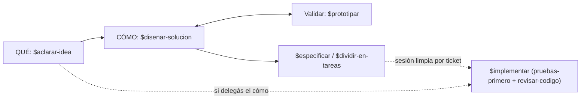

# Mis skills

Colección de skills en español para agentes de programación (Codex, Claude, Antigravity/Gemini y compatibles con `SKILL.md`).

## Instalar y actualizar

### Con Skills CLI (recomendado, multi-agente)

Instalá todas las skills en el proyecto (requiere Node.js 22.20+; en PowerShell usá `npx.cmd` si hace falta):

```bash
npx skills add nahuel1506/mis-skills --skill "*" -y
```

Para actualizar después:

```bash
npx skills update --project
```

Usá `--skill <nombre>` para instalar solo algunas, `-g` para instalarlas globalmente (`npx skills update --global` para actualizar) o `-a <agente>` para elegir entornos específicos. [Docs de Skills CLI](https://github.com/vercel-labs/skills/blob/main/docs/commands.md#skills-add)

<details>
<summary>Alternativa: instalar por carpetas con GitHub CLI (<code>gh</code>)</summary>

Útil si preferís agruparlas en `.agents/skills/ingenieria/` y `.agents/skills/referencias/` (requiere `gh auth login`).

```powershell
$origen = 'nahuel1506/mis-skills'
$categorias = 'ingenieria', 'referencias'
$rutas = gh api "repos/$origen/git/trees/main?recursive=1" --jq '.tree[].path'
if ($LASTEXITCODE -ne 0) { throw 'No se pudo consultar la colección' }

foreach ($ruta in ($rutas -match '^skills/[^/]+/[^/]+/SKILL\.md$')) {
  $categoria, $nombre = ($ruta -split '/')[1, 2]
  if ($categoria -notin $categorias) { continue }
  $destino = ".agents/skills/$categoria"
  if (Test-Path -LiteralPath "$destino/$nombre/SKILL.md") { continue }
  gh skill install $origen $ruta --dir $destino
  if ($LASTEXITCODE -ne 0) { throw "No se pudo instalar $nombre" }
}
```

Para actualizar las carpetas instaladas:

```powershell
gh skill update --all --dir .agents/skills/ingenieria
gh skill update --all --dir .agents/skills/referencias
```

Si una skill se elimina o fusiona en el origen, borrá su carpeta local después de actualizar.

</details>

## Flujo recomendado

Invocá una skill por su nombre según tu entorno (`$nombre` en Codex, `/nombre` en Claude/compatibles). Solo **4 skills** son **Auto** para mantener mínimo el contexto fijo.



### Cómo elegir flujo y tipo de modelo

No hace falta recorrer todo el flujo ni cambiar de modelo en cada paso: **cambiar de modelo o nivel de esfuerzo en medio de un hilo rompe el caché de contexto** y puede salir más caro que terminar con el mismo. Y delegar lógica difícil a un modelo débil suele costar más en retrabajo y bugs.

| Situación | Flujo sugerido | Tipo de modelo recomendado |
| --- | --- | --- |
| **Pedido claro y acotado** | Directo a `$implementar` | Un solo modelo **equilibrado** (o **potente** si toca lógica delicada/arquitectura) de principio a fin, sin cambiar a mitad de camino. |
| **Querés definir bien el qué y delegar el cómo** | `$aclarar-idea` → `$implementar` *(pasando por `$especificar` si las rondas fueron largas)* | **Máximo razonamiento** para aclarar el qué y **potente** para implementar (como delegás el diseño técnico, no conviene bajar a un modelo débil). Si las rondas fueron breves, implementá en el mismo hilo para aprovechar el caché; si se extendieron, bajá a spec y abrí sesión limpia. |
| **Idea clara, falta definir el cómo** | `$disenar-solucion` → `$implementar` | **Máximo razonamiento** para diseñar. Si el cambio es chico, implementalo en el mismo hilo con ese modelo (aprovechás contexto y caché). Si el hilo creció mucho, abrí sesión limpia para implementar. |
| **Idea verde o entrega grande** | `$aclarar-idea` → `$disenar-solucion` → `$especificar` / `$dividir-en-tareas` → `$implementar` | **Máximo razonamiento** para aclarar, diseñar y dividir. Después, **una sesión limpia por ticket**, eligiendo modelo según la dificultad real de ese ticket (rápido/equilibrado para cambios mecánicos o directos; potente para lógica compleja, concurrencia o arquitectura). |
| **Bug difícil o auditoría** | `$diagnosticar-errores` / `$mejorar-arquitectura` | **Máximo razonamiento** en el hilo principal, delegando barridos amplios a subagentes de solo lectura. |

## Catálogo

### Ingeniería

| Skill | Para qué sirve | Invocación |
| --- | --- | --- |
| [$aclarar-idea](./skills/ingenieria/aclarar-idea/SKILL.md) | Definir **qué** construir por rondas y registrar glosario o ADR si aplica. | Manual |
| [$disenar-solucion](./skills/ingenieria/disenar-solucion/SKILL.md) | Decidir **cómo** construir con criterio firme sobre código real, contratos y modos de fallo. | Manual |
| [$prototipar](./skills/ingenieria/prototipar/SKILL.md) | Resolver una duda con un experimento descartable y ejecutable. | Manual |
| [$especificar](./skills/ingenieria/especificar/SKILL.md) | Bajar acuerdos a una spec verificable y autosuficiente. | Manual |
| [$dividir-en-tareas](./skills/ingenieria/dividir-en-tareas/SKILL.md) | Dividir una entrega en tickets acotados para sesiones limpias. | Manual |
| [$implementar](./skills/ingenieria/implementar/SKILL.md) | Construir y verificar un pedido, spec o ticket cuidando arquitectura y contexto. | Manual |
| [$pruebas-primero](./skills/ingenieria/pruebas-primero/SKILL.md) | Desarrollar o corregir con ciclos proporcionales rojo, verde y refactorización. | Auto |
| [$revisar-codigo](./skills/ingenieria/revisar-codigo/SKILL.md) | Auditar cambios, una rama o un PR contra normas, ADR y requisitos. | Auto |
| [$diagnosticar-errores](./skills/ingenieria/diagnosticar-errores/SKILL.md) | Aislar la causa de un fallo o regresión con evidencia reproducible. | Auto |
| [$mejorar-arquitectura](./skills/ingenieria/mejorar-arquitectura/SKILL.md) | Auditar el código para priorizar mejoras estructurales con evidencia. | Manual |
| [$retrospectiva](./skills/ingenieria/retrospectiva/SKILL.md) | Proponer mejoras al flujo a partir de problemas observados en una sesión. | Manual |

### Referencias y aprendizaje

| Skill | Categoría | Invocación | Para qué sirve |
| --- | --- | --- | --- |
| [$modelar-dominio](./skills/referencias/modelar-dominio/SKILL.md) | Referencia | Auto | Fijar vocabulario del negocio (`GLOSSARY.md`) y norte de decisiones (`docs/adr/`). |
| [$escribir-para-agentes](./skills/referencias/escribir-para-agentes/SKILL.md) | Referencia | Manual | Redactar `AGENTS.md` o skills efectivas sin ruido. |
| [$aprender](./skills/aprendizaje/aprender/SKILL.md) | Aprendizaje | Manual | Estudio guiado basado en evidencia y práctica directa. |

<details>
<summary>Dependencias al instalar por nombre</summary>

| Si instalás… | Incluí también… |
| --- | --- |
| `aclarar-idea` o `disenar-solucion` | `modelar-dominio` si registrás glosario o ADR |
| `implementar` | `pruebas-primero` y `revisar-codigo` |
| `diagnosticar-errores` | `pruebas-primero` y `revisar-codigo` si aplicás y revisás la corrección |

</details>

## Convenciones por repositorio

En el `AGENTS.md` de cada proyecto conviene declarar solo lo no evidente: separación de capas, comandos de verificación, componentes reutilizables y enlace a `DESIGN.md` si existe.

## Validar la colección

Antes de publicar cambios en este repositorio:

```bash
node scripts/validate-skills.mjs
```
